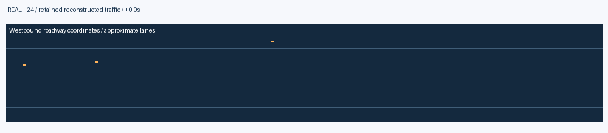
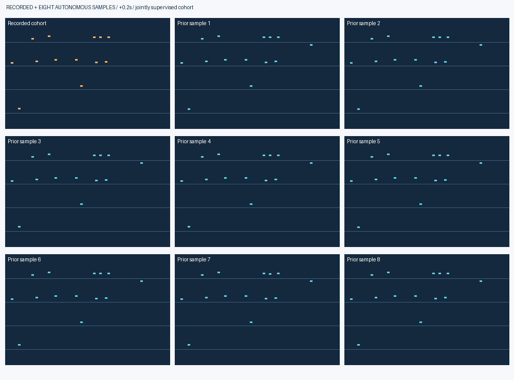
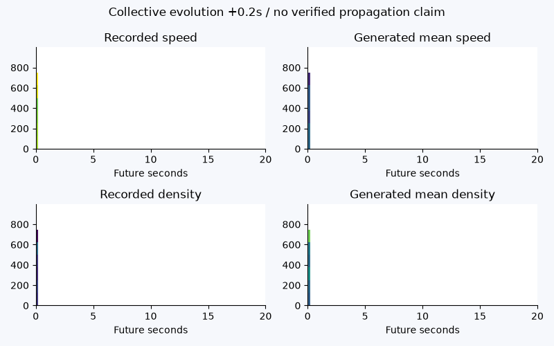
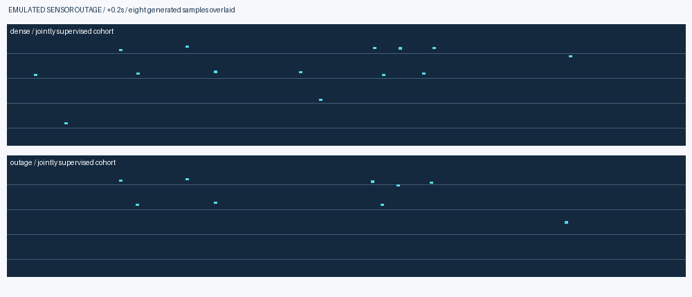

# Phase 4C · checkpoint-backed evidence gallery

Seed-101, 30-update joint checkpoints after an identical 300-update warm start on authentic November 21 data.
These are preliminary single-day joint-loss results, not a convergence or independent-date claim. Vehicle forecasts have direct cohort supervision; individual future arrivals are not generated.
The historical Phase 4/4B galleries remain unchanged.

| Evidence | Preview |
|---|---|
| Real reconstructed highway traffic |  |
| Recorded cohort and eight autonomous futures |  |
| Collective field evolution |  |
| Emulated sensor outage |  |

[Learning curves](learning_curves.png) · [Baseline comparisons](baseline_horizons.png) ·
[Calibration and validity](calibration_and_validity.png) · [Physical consistency](physical_consistency.png) · [Population consistency](population_consistency.png) ·
[Sensor outage](missing_sensors.png) · [Actual trajectories](real_trajectories.png) ·
[Speed](speed_kymograph.png) · [Density](density_kymograph.png) · [Flow](flow_kymograph.png) ·
[Information flow](information_flow.png)

The standalone interactive viewer is kept in the private recovery artifact because
it embeds selected authentic trajectory arrays. Its SHA256 and exact evaluated
array provenance are recorded in `provenance.json`; the source template is versioned.
The viewer supports three scenarios, all three models, dense/outage history, eight prior
samples, recorded comparison, a physical-time scrubber and speed/density/flow bands.
No future truth initializes the forecasts. No congestion-wave propagation is claimed.

[Joint microscopic learning curves](joint_micro_learning_curves.png). Graph-off removes graph messages but retains aggregate feedback. Independent removes graph messages, shared microscopic innovations and macro feedback from vehicle dynamics; its separate head predicts total fields. All three share the same warm start and additional update budget.

Displayed partition: **development_test**.

[Microscopic interaction view](05_micro_interactions.gif): fixed central 250 m, first prior sample, geometric message neighborhoods. These are not causal links.
